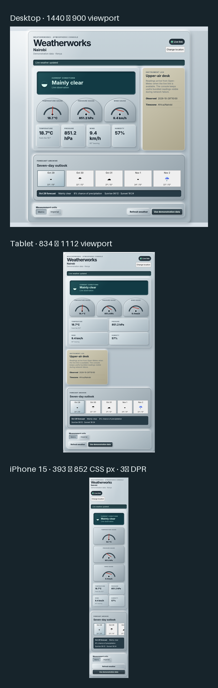
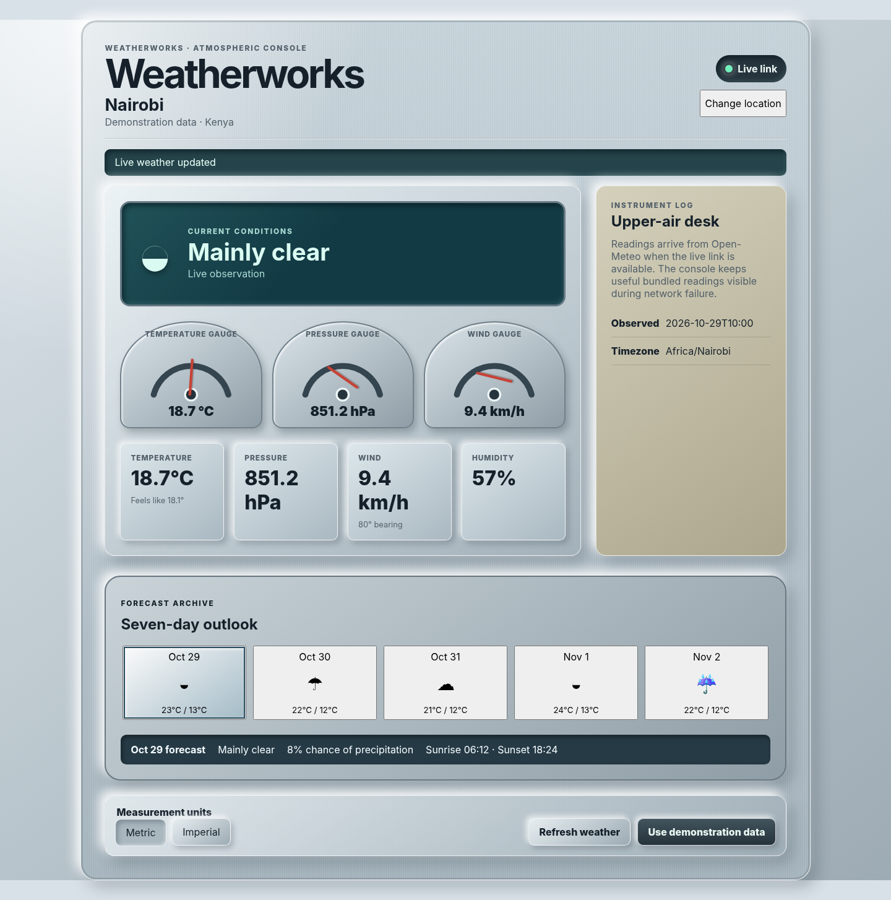
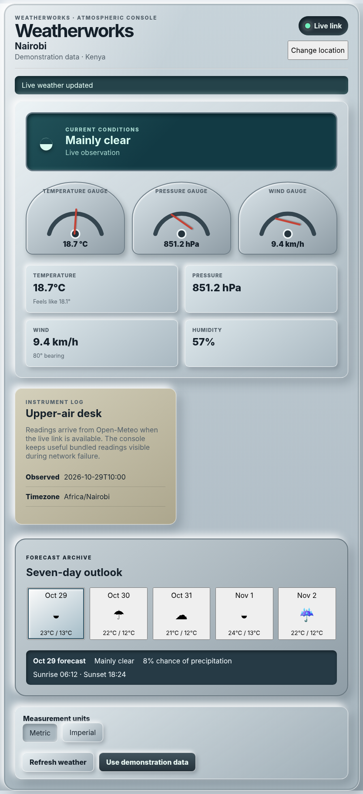
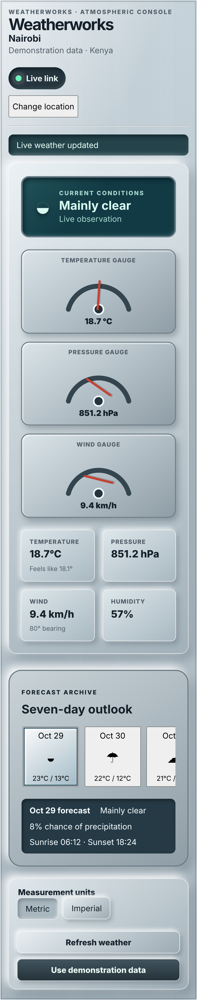

# Weatherworks

A Motion-powered skeuomorphic weather station that turns live Open-Meteo readings into a tactile, responsive instrument console.



## Responsive previews

- **Desktop — 1440 × 900 viewport**
  
- **Tablet — 834 × 1112 viewport**
  
- **iPhone 15 — 393 × 852 CSS-pixel viewport, 3× device scale factor**
  

## Features

- Live no-key forecast data and location search through Open-Meteo.
- Deterministic bundled Nairobi readings displayed immediately at startup.
- Initial API failures retain demonstration data; later refresh failures preserve the latest successful live snapshot.
- Metric and imperial readings, selectable forecast days, animated gauges, tactile controls, and an accessible location combobox.
- Responsive desktop, tablet, and real iPhone 15 profiles with 44-pixel minimum controls and no horizontal overflow.
- Keyboard operation, visible focus treatment, semantic status messages, and `prefers-reduced-motion` support.

## Motion and material system

Weatherworks uses `motion/react` for spring-driven SVG gauge needles, pressed-button gestures, shared forecast selection layout, status transitions, and animated search surfaces. `MotionConfig reducedMotion="user"` switches travel-dependent effects to immediate or opacity-focused updates.

The interface is source-owned CSS rather than a third-party visual kit. Tokens define a consistent upper-left light source, raised and inset shadows, brushed metal, plastic controls, glass displays, signal lamps, spacing, focus rings, and responsive density.

## Data flow

```text
Bundled Nairobi snapshot ──> useful first render
          │
          └──> Open-Meteo forecast request
                 ├── success ──> normalized live snapshot
                 └── failure ──> bundled snapshot or last live snapshot

Location query ──> Open-Meteo geocoding ──> keyboard-selectable result
                                      └──> forecast request for selection
```

Open-Meteo responses are validated and normalized into a small weather domain model before reaching the controller and presentation components. Full service-worker caching and guaranteed cold-start offline operation are intentionally outside scope.

## Stack

- React 19 and TypeScript 6
- Vite 8
- Motion 14 (`motion/react`)
- Open-Meteo forecast and geocoding APIs
- Vitest, Testing Library, MSW, and jsdom
- Playwright with desktop, tablet, and iPhone 15 Chromium projects
- Pillow for screenshot dimension validation and contact-sheet assembly

## Getting started

### Prerequisites

- Node.js with npm
- Python 3 with Pillow for rebuilding the contact sheet

### Install and run

```bash
npm ci
npm run dev
```

Open the local URL printed by Vite. No API key or environment file is required.

### Production build

```bash
npm run build
npm run preview -- --port 4173
```

## Testing

```bash
npm run lint
npm run typecheck
npm test
npm run test:e2e
npm run check
python scripts/build_contact_sheet.py
```

`npm run check` runs linting, TypeScript validation, 33 unit/component tests, a production build, and 24 Playwright tests across the named responsive projects, including the three visual-capture cases.

## Project structure

```text
src/app/             Application composition
src/components/      Station, gauges, forecast, search, and controls
src/weather/         Domain model, fallback data, API clients, controller
src/styles/          Material tokens and responsive station styling
tests/               Playwright acceptance and visual capture suites
docs/images/         Real Chromium screenshots and contact sheet
scripts/             Screenshot validation/contact-sheet tooling
```

## Accessibility

The station uses native buttons and radio inputs, a combobox/listbox search pattern, an ARIA meter representation for each SVG gauge, deliberate live-region ownership, visible focus states, keyboard forecast selection, and reduced-motion behavior. Browser tests cover keyboard workflows, responsive reflow, minimum control height, and reduced-motion operation.

## API attribution

Weather data and location search are provided by [Open-Meteo](https://open-meteo.com/). This frontend uses public no-key endpoints and stores no user credentials.

## Deployment

**Not deployed.** Run the application locally using the commands above. The public repository is the verified project showcase.

## Contributing

Fork the repository, create a focused branch, run `npm run check`, and open a pull request describing the behavior and verification performed.

## License

[MIT](LICENSE)

## Author

Built by [@hersaintel](https://github.com/hersaintel).
